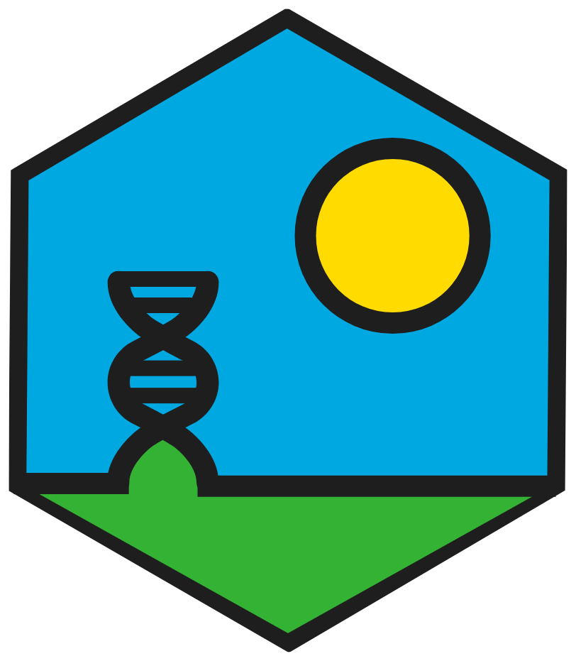

### Hi there :wave: 
#### I'm Luke a Genomic Breeding Scientist & Global Science Manager for Barenbrug

<table>
<tr>
<td width="120">

</td>
<td>

I enjoy everything :dna: genomics, :seedling::cow2: genomic selection, :computer: Linux, R and Nextflow. Give us a shoutout :speech_balloon: if you need any assistance or want to collaborate on something.

</td>
</tr>
</table>

